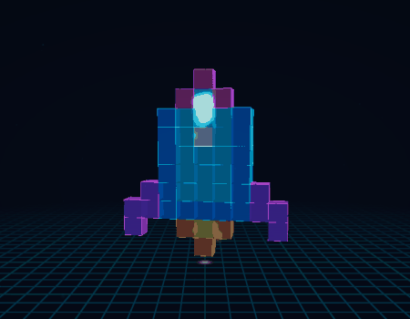
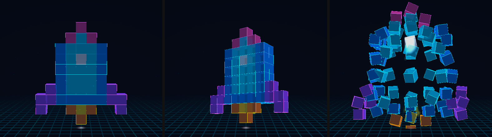
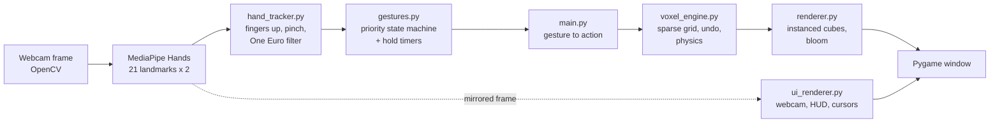

# 3D Voxel Editor

Build voxel models in mid-air with your hands. A webcam and MediaPipe track both hands; pinch to place blocks, point to erase, make a fist to grab the model, and open both palms to spin it. Rendering is real-time OpenGL through ModernGL, with bloom and a holographic look.

[](LICENSE)


<p align="center">
  
</p>
<p align="center"><sub>Rendered by the app itself: the voxel engine's rotate, scatter and restore actions on a scripted scene, captured with no webcam attached (<a href="tools/capture_readme_assets.py">script</a>). In normal use each step is triggered by a hand gesture.</sub></p>

## Why this exists

Most hand-tracking demos stop at drawing a skeleton over the video. This project goes one step further and uses the hands as the only input device for a small 3D editor, which raises problems a demo never hits: two hands making different gestures at once, gestures that look alike for a few frames, holds that must not fire by accident, and a cursor that has to stay steady enough to hit a one-unit grid cell.

The answer here is a priority-ordered gesture state machine with hold timers, One Euro filtering on fingertip and palm positions, and an engine that keeps edits cheap (sparse storage, whole-model transforms as a single matrix).

## What you can do

<p align="center">
  
</p>
<p align="center"><sub>Front view, two-axis rotation, and scatter, rendered from the same scene by <code>tools/capture_readme_assets.py</code>.</sub></p>

| Gesture | Action |
| --- | --- |
| Left pinch (hold 0.5 s) | Place voxels; keep holding and move to build continuously |
| Right pinch + left index point | Paint over voxels to mark them; release the pinch to delete them all |
| Right fist | Grab and move the whole model |
| Both palms open (hold 1 s) | Rotate: spread hands to spin, raise one hand to tilt |
| Both fists (1 s) | Reset position and rotation |
| Left thumb down / up | Scatter the model with physics / pull it back together |
| Left victory sign | Cycle the color palette |
| Right victory | Start disco colors; again to restore the original colors |
| Right open palm (during disco) | Freeze the current disco colors |
| Right thumb up alone (5 s) | Clear everything (long hold so it can't fire by accident) |

The keyboard covers the rest: `S` save to `voxel_scene.json`, `L` load, `E` export `voxel_export.obj` with an `.mtl` of colors, `Ctrl+Z` / `Ctrl+Shift+Z` undo and redo, `A` toggle AR mode (webcam behind the scene), `H` help, `D` debug overlay. Full list in [prd.md](prd.md#keyboard-controls).

## How it works



Each frame: OpenCV reads the camera, MediaPipe runs on the **unmirrored** frame (so left and right hands are labelled correctly), and only then is the frame flipped for display. `hand_tracker.py` turns landmarks into finger states and smoothed fingertip positions, `gestures.py` decides what the hands mean, `main.py` applies it to the engine, and two renderers draw the scene and the overlay.

### Design decisions worth reading

- **Gesture priority instead of a classifier.** Gestures are checked in a fixed order (both fists, both palms, full reset, delete, grab, place, scatter/restore), and the first match wins. (Color and disco gestures are edge-triggered and checked separately.) Two-hand gestures sit above one-hand ones, so "right pinch + left point" is never mistaken for a plain left action. The whole table, with timers and detection rules, is in [prd.md](prd.md).
- **Hold timers with a visible loading ring.** Every gesture that edits or moves the model needs a short hold (0.5 to 5 s) and draws progress around the hand, so a hand passing through a fist or a pinch on its way to another pose doesn't fire anything.
- **Delete collects, then commits.** While the delete gesture is held, voxels under the left fingertip go into a set; nothing is removed until the right pinch releases, which then deletes the whole batch. An earlier version fired an event per voxel and the 0.3 s action cooldown blocked the release event, leaving delete stuck on. The gesture recognizer now holds a direct reference to the engine to avoid that.
- **Sparse storage.** Voxels live in `Dict[Tuple[int,int,int], Voxel]`. Lookup, placement and deletion are O(1), and empty space costs nothing. The cap is 10,000 voxels (`config.py`).
- **Move and rotate the model with one matrix.** Grab and rotate change a single model matrix in the shader, not the voxel data. The grab offset moves in whole-cell steps and is committed to the voxels when the grab ends, so later edits still land on integer cells; rotation stays in the matrix.
- **Instanced rendering.** The renderer packs 10 floats per voxel (position, color, rotation, selected flag) into an instance buffer and draws all cubes with one instanced call, plus one more for their wireframe edges. The buffer is rebuilt in Python every frame, which is fine at this scale but is the first thing to optimize for bigger scenes. A bloom post-process (bright-pass extract, blur, combine) adds the glow.
- **Placement is 2D on purpose.** Hand x/y map onto the z = 0 plane, so every placed block lands on a predictable cell and the delete cursor matches what you see. You get a 3D view of the result by rotating it with both palms.

More detail: [architecture.md](architecture.md) (coordinate systems, render pipeline) and [memory.md](memory.md) (known gotchas and debugging notes).

## Quick start

You need Python 3.11, a webcam, and a GPU driver with OpenGL 3.3.

```bash
git clone https://github.com/ParshvCrafts/3D_Voxel_Editor.git
cd 3D_Voxel_Editor
python -m venv .venv
.venv\Scripts\activate            # macOS/Linux: source .venv/bin/activate
pip install -r requirements.txt
python main.py
```

Keep both hands in frame. Press `H` for the help overlay and `D` to see what the gesture recognizer thinks your hands are doing. Without a camera, the app starts anyway on a dark background (keyboard and saved scenes still work).

Run the unit tests (no camera or GPU needed):

```bash
python -m unittest discover -s tests
```

Regenerate the images in this README (opens a window for a few seconds, no camera needed):

```bash
python tools/capture_readme_assets.py
```

## Status

Developed on Windows 11 with Python 3.11.9 and an OpenGL 3.3 core context.

**Verified working** (hand-tested by the author, see [progress.md](progress.md)): place, delete, grab, two-hand rotation, transform reset, full reset, color cycling, AR mode, save/load, OBJ export, undo/redo.
**Covered by unit tests** ([tests/test_voxel_engine.py](tests/test_voxel_engine.py), 5 tests): clear and reset history, grab snapping with undo/redo, save/load round trip, disco color restore, rejection of malformed scene files.
**Implemented but not re-verified:** disco mode gestures, scatter/restore by thumb gesture (the engine actions themselves are shown in the GIF above), symmetry mode, box selection.

Not tested on macOS or Linux.

## Project layout

```text
main.py             app loop, keyboard, gesture -> action routing
hand_tracker.py     MediaPipe wrapper, finger states, One Euro smoothing
gestures.py         priority-ordered gesture state machine
voxel_engine.py     sparse voxel grid, transforms, physics, undo/redo, save/load/OBJ
renderer.py         ModernGL scene: instanced voxels, grid, wireframes, bloom
ui_renderer.py      webcam panel, HUD, cursors, particles
utils.py            filters, ray casting, math helpers
config.py           every tunable value (timers, thresholds, colors, camera)
shaders/            GLSL for voxels, grid, bloom, HUD, particles
tests/              voxel engine unit tests
tools/              README asset capture script
```

## License

[MIT](LICENSE) © Parshv Patel
